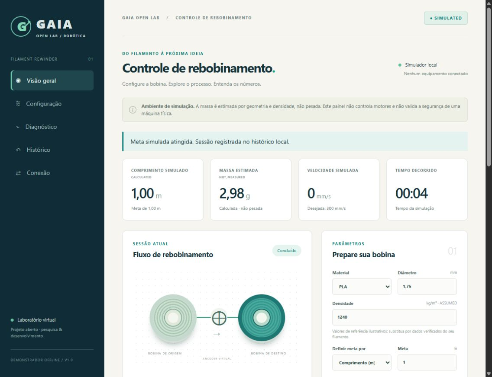

# GAIA Open Filament Rewinder

**Uma rebobinadora para estudar, simular e futuramente construir.** Proposta de iniciativa do GAIA Robótica — UFTM, inspirada na necessidade atribuída à Verboera 3D no pedido original. Sem alegação de parceria, endosso institucional ou equipamento construído. [English](README.en.md).

Transfere filamento **já fabricado** entre carretéis. Não é extrusora, recicladora ou linha de produção de filamento. Esta versão oferece uma demonstração web funcional, cálculos reproduzíveis, firmware inicial compilável e projeto mecânico conceitual. **Nenhum protótipo físico foi construído ou validado neste trabalho.**

## Experimente agora no computador

Com Node.js 24 ou superior, abra um terminal nesta pasta:

```sh
npm start
```

Abra [a demonstração local](http://127.0.0.1:4173/software/web/). Não é necessário instalar pacotes npm, conectar um ESP32 ou criar conta. Abra pelo servidor, não por duplo clique no HTML, pois a interface usa módulos JavaScript. Para encerrar, pressione Ctrl+C no terminal.

```sh
npm test
npm run examples
npm run build
```

O build prepara `build/site/` para hospedagem estática; **não publica nada**. O workflow manual de Pages está pronto para uso após autorização, criação do repositório público e habilitação de GitHub Pages. Não existe URL pública de demonstração nesta entrega local.

## Lite ou Smart?



| | Lite — proposta econômica | Smart — arquitetura modular |
|---|---|---|
| Acionamento | Motorredutor CC e módulo PWM independente | Motorredutor, driver e ESP32 propostos |
| Microcontrolador | Dispensável | ESP32; firmware inicial compilado |
| Guia lateral | Manual, por manípulo fora das proteções | Mecanismo motorizado proposto; ainda não implementado no firmware |
| Tensão | Ajuste passivo proposto | Ajuste passivo; realimentação de tensão permanece pendente |
| Comprimento | Sem medição automática nesta configuração | Roda independente e encoder propostos; cálculo implementado |
| Massa real | Balança externa, com tara | Balança externa; interface mostra **massa estimada**, não pesagem |
| Interface e metas | Controle local; sem parada automática por meta | Simulador web funcional; firmware com lógica de meta e falhas |
| Conexão navegador ↔ máquina | Não se aplica | HTTP/WebSocket futuro, desabilitado nesta versão; firmware tem protocolo serial |

## O que está pronto e o que ainda falta

| Entrega | Evidência e limite |
|---|---|
| Interface pt-BR | Dashboard, material, meta m/g estimados, velocidade, iniciar/pausar/parar, calibração, diagnóstico e histórico local |
| Simulador | Dados identificados como `SIMULATED`; aceleração e contagens inteiras; modelo ideal sem inércia, escorregamento ou frenagem real |
| Metrologia | Conversões, calibração, incerteza, torque/velocidade e pré-dimensionamento; exemplos calculados com hipóteses explícitas |
| Firmware ESP32 | PWM, encoder quadratura, estados, metas, falhas, NVS e serial; compilado, **atuação bloqueada por padrão** |
| Mecânica | OpenSCAD original paramétrico Lite/Smart, CSG e STL real da base; conceitual, sem toleranciamento ou liberação para fabricação |
| Ilustrações | 11 SVG originais: vistas, trajetória, medição, transmissão, guia, elétrica e comunicação |
| BOM | 35 itens em Excel/CSV; sem preços inventados. Cobertura inicial de cotações 0%; totais `UNKNOWN` |
| Publicação | Arquivos e workflows preparados localmente; push público e deploy dependem de autorização explícita |

## Onde encontrar

- [Guia completo em português](docs/pt-BR/guia-completo.md): conceitos, impressão, montagem, elétrica, firmware, interface, calibração e diagnóstico.
- [Segurança e critérios antes de energizar](docs/pt-BR/seguranca.md).
- [Cálculos e limites do modelo](docs/en/engineering.md), [arquitetura/protocolo](docs/en/architecture.md) e [pesquisa comparativa](docs/en/research.md).
- [Mecânica e componentes propostos](hardware/README.md), [diagramas](diagrams/README.md), [BOM editável](bom/README.md) e [firmware](firmware/README.md).
- [Evidência por fase e pendências](docs/en/validation.md), [contribuição](CONTRIBUTING.md) e [histórico](CHANGELOG.md).

`CALCULATED` significa cálculo; `ASSUMED`, hipótese; `SIMULATED`, simulação; `NOT_MEASURED` e `NOT_VERIFIED`, dado ou verificação ausente. Densidades padrão são ilustrativas: obtenha dados do seu filamento. Aumento do raio de enrolamento muda torque e rotação, mas não deve substituir a medição linear por encoder independente.

## Segurança e licença

A interface não é parada de emergência. Não ligar motores, alterar flags de validação, fabricar a máquina completa ou interpretar os diagramas funcionais como esquema elétrico revisado. Guardas, retenção, alimentação, limite de corrente, intertravamentos e parada física exigem projeto e ensaios próprios. Consulte o guia antes de qualquer bancada.

Fontes originais sob [MIT](LICENSE). Projetos de referência são citados, sem código/CAD importado nem alegação de pioneirismo. Licenças de componentes e projetos externos permanecem próprias. Não há garantia de segurança, aptidão comercial ou conformidade do equipamento.
