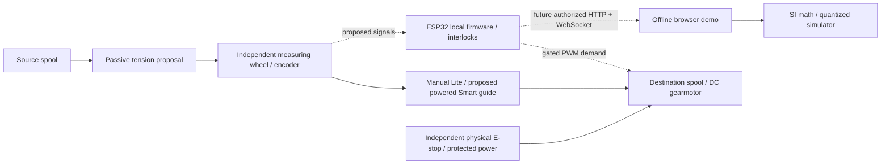

# Architecture, requirements and transport boundary

## Requirements and present scope

R01 transfer existing filament, never extrusion; R02 independent Lite and Smart; R03 independent line metering; R04 estimated mass explicitly distinguished from scale mass; R05 no automatic restart; R06 local fault latch and physical energy isolation; R07 offline browser demonstrator; R08 meaningful mathematical/state tests; R09 original editable CAD/diagrams; R10 no invented quotations; R11 publication after explicit approval. README and validation map these to implemented, conceptual and future capabilities.



Vanilla browser ES modules share pure math and an isolated stateful simulator. No backend, cloud, AI provider, hardware API or external font/CDN is needed. A loopback-only static Node server exposes web/simulator assets with no mutation endpoint or device connections. Git, BOM, personal files and arbitrary paths are not served. LocalStorage contains only validated simulated configuration/calibration and up to100 final operation records; active motion is not persisted. Browser export is an explicitly requested local JSON file.

Firmware uses Arduino-ESP32 via pinned PlatformIO for reproducibility and a portable C++ core. Bare ESP-IDF would provide direct peripheral APIs but increase initial setup complexity; PCNT/speed-loop integration remain future work. The C++ core is intentionally separate from ESP APIs and host-tested. No physical simulator is mistaken for native execution. Three compile-time actuation gates plus local hardware/persistence/PWM readiness keep the default image disabled. Motor speed is open-loop command, not measured linear velocity; native ISR counts are quadrature x4, with proposed pins and unverified maximum edge rate.

## State semantics

IDLE→RUNNING requires explicit start; RUNNING↔PAUSED requires explicit pause/resume; stop preserves counts and cannot resume the same session; goal completion sets zero demand. Active interlock/no-motion/reverse/timing failures latch FAULT, and reset returns IDLE only after local recovery. A new explicit start is always required. First fault stays latched for diagnostics/history. Firmware counts physical drift during pause; browser pause freezes idealized simulated motion. These are deliberately different physical assumptions, not a shared timing guarantee. See the software contract and firmware README.

## Versioned messages

Current implemented transport: newline-delimited serial at115200 baud, bounded commands/JSON responses; [firmware README](../../firmware/README.md) is authoritative. No Wi-Fi credentials, HTTP listener or WebSocket exists. Offline UI connection settings are visibly disabled.

Proposed future endpoints (NOT IMPLEMENTED): `GET /api/v1/snapshot`, `POST /api/v1/commands`, WebSocket `/api/v1/events`. Require a reviewed authorization/origin model, local arm, stale-message protection, heartbeat lease, bounded parsing, command acknowledgment and independent physical stop. Do not expose these endpoints on an untrusted LAN by enabling CORS or removing authentication.

Proposed HTTP/WS command envelope:

```json
{"schemaVersion":"1.0","requestId":"unique-session-sequence","command":"pause","expectedState":"RUNNING"}
```

Snapshot example, explicitly synthetic and not a captured machine:

```json
{"schemaVersion":"1.0","mode":"SIMULATED","state":"PAUSED","lengthM":1.0,"massKg":0.00298255,"speedMps":0,"elapsedS":12.0,"encoderCounts":6366,"fault":null}
```

The abbreviated example rounds fields; an actual quantized snapshot has its exact count-derived length. Actual firmware mode is `FIRMWARE_UNVALIDATED`, `fault:"NONE"` means no fault, and `speedMps` is demand. A future adapter must normalize fault semantics, declare data provenance, reject unknown mode/schema, validate all fields and never trust browser estimates as interlocks. Bounds differ between initial firmware and the demonstration, so a future live client must negotiate/validate the intersection rather than silently coerce config. Detailed firmware status includes config/sensors/alerts, but not the independent browser history.

## Critical gaps and priority

CRITICAL: no verified mechanics/guards/energy isolation, selected encoder electrical interface, physical stop/force/thermal results. HIGH: powered traverse, speed feedback, receiver-jam/tension sensing, NVS power-loss tests and live command authorization. MEDIUM: part tolerances, enclosure, exact component sourcing, repeatable calibration and real mobile/browser matrices. LOW: further visual polish. None of these gates is closed by passing unit tests or producing a watertight STL.
